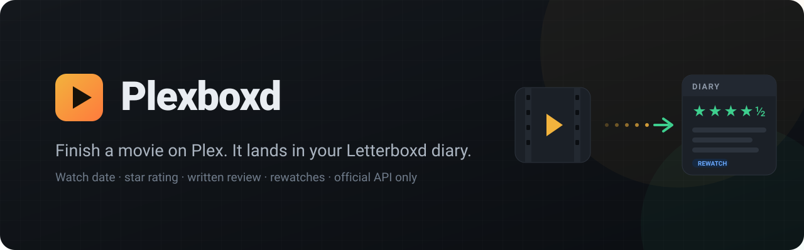
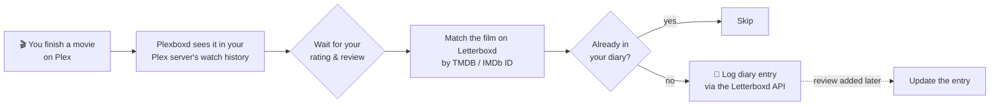

<p align="center">
  
</p>

<p align="center">
  
  
  
  
  
</p>

<p align="center">
  <b>Plexboxd</b> keeps your Letterboxd diary in sync with what you watch on Plex.<br>
  Finish a movie and it's logged on the right date, with your rating, your review, and the rewatch flag if you've seen it before.
</p>

<p align="center">
  <a href="#quick-start">Quick start</a> ·
  <a href="#how-it-works">How it works</a> ·
  <a href="#configuration">Configuration</a> ·
  <a href="#faq">FAQ</a>
</p>

---

> [!IMPORTANT]
> **Plexboxd uses the official Letterboxd API, and nothing else.**
> It doesn't scrape letterboxd.com, drive a browser, reuse browser cookies, or get around any of Letterboxd's protections. Every request to Letterboxd goes through [their API](https://api-docs.letterboxd.com/) with your permission via Letterboxd's own sign-in.

> [!WARNING]
> **You need your own Letterboxd API access to use Plexboxd.**
> Letterboxd's API isn't open to everyone: access is granted case by case. Plexboxd does **not** come with shared credentials, so each person who runs it has to request their own from Letterboxd. Approval is entirely up to Letterboxd and can take a while. See [Getting your own Letterboxd API access](#getting-your-own-letterboxd-api-access).

## Features

| | |
|---|---|
| 🎬 **Automatic diary entries** | Every movie you finish on Plex is logged with the date you watched it. |
| ⭐ **Ratings come with it** | Your Plex star rating carries over exactly. Both use half stars, so 4.5★ stays 4.5★. |
| ✍️ **Reviews too** | Write a review on Plex and the same text, with the spoiler flag, becomes your Letterboxd review. |
| 🔁 **Rewatch detection** | Seen it before? It's marked as a rewatch, based on your Plex history and your diary. |
| ⏳ **Time to think** | Waits a while after the credits (60 minutes by default) so you can rate and review on Plex first. |
| 📝 **Late reviews welcome** | Review it the next day? The entry is updated for up to a week afterwards. |
| 🧹 **No duplicates** | Already logged it by hand? It's skipped. |
| 🌊 **No flood on day one** | Only watches from the day you install are synced. Backfilling is opt-in. |
| 👀 **Preview mode** | Check each entry and press **Post** until you trust it, then switch to fully automatic. |
| 🖥️ **Web dashboard** | Sign-ins, recent activity, settings and diagnostics in one page. |
| 🏠 **Runs at home** | One Docker container on your NAS or server. Your data stays on your hardware. |

## How it works



1. **Watch.** Plexboxd checks your Plex server's watch history every few minutes and picks up movies played on your account. TV episodes are ignored, since Letterboxd is for films.
2. **Wait.** It gives you a grace period after the movie ends (60 minutes by default), so you can rate or review it on Plex first.
3. **Gather.** It reads your star rating from your Plex server and your written review from Plex's reviews service.
4. **Match.** It finds the film on Letterboxd by its TMDB ID (falling back to IMDb), so titles never need to match exactly.
5. **Log.** If the film isn't already in your diary for that day, it creates a diary entry through the official Letterboxd API. If you review the film later, it updates that entry.

## Quick start

**You'll need:**
- A Plex Media Server you own. No Plex Pass is required.
- Docker and Docker Compose: a NAS (Synology, UGREEN, Unraid, TrueNAS…), a home server, or any always-on machine.
- **Your own** Letterboxd API client ID and secret, requested from Letterboxd ([how](#getting-your-own-letterboxd-api-access)). Plexboxd won't work without them.

**1. Get the code**

```bash
git clone https://github.com/RamenNuudlss/plexboxd.git
cd plexboxd
```

**2. Add your Letterboxd API credentials to `docker-compose.yml`**

```yaml
services:
  plexboxd:
    build: .
    container_name: plexboxd
    restart: unless-stopped
    network_mode: host            # dashboard on port 8977
    environment:
      - TZ=America/New_York       # your time zone, so diary dates are right
      - LETTERBOXD_CLIENT_ID=your-client-id
      - LETTERBOXD_CLIENT_SECRET=your-client-secret
      - UI_PASSWORD=              # optional: password-protect the dashboard
    volumes:
      - ./data:/data
```

**3. Start it**

```bash
docker compose up -d --build
```

**4. Open the dashboard** at `http://<your-server-ip>:8977` and:

1. Click **Sign in with Plex**. You approve access on plex.tv, and Plexboxd never sees your Plex password.
2. Choose your Plex server.
3. Click **Sign in with Letterboxd**. You approve access on Letterboxd's own page, and Plexboxd never sees your Letterboxd password.
4. Watch a movie. 🍿

> [!TIP]
> Preview mode is **on** by default, so new entries wait on the dashboard until you press **Post**. Once the matches look right, turn it off in **Settings** and everything logs automatically.

## The dashboard

Everything happens at `http://<your-server-ip>:8977`:

- **Status at a glance.** Whether Plex, Letterboxd and Plex reviews are connected, and whether entries post automatically or wait in preview mode.
- **Recent watches.** Every movie with its watch date, rating, review, rewatch and spoiler tags, and its status (Waiting, Ready, Logged, Skipped or Failed). Each row has **Post**, **Skip** and **Retry** buttons and a link to the film on Letterboxd.
- **Check now.** Look at Plex right away instead of waiting for the next check.
- **Settings.** Everything in the table below.
- **Diagnostics.** Live checks against Plex and Letterboxd with your sign-ins, for when something isn't syncing.

## Configuration

### Settings (in the dashboard)

| Setting | Default | What it does |
|---|---|---|
| Preview mode | On | Hold entries until you press **Post** |
| Sync star ratings | On | Carry your Plex rating over |
| Sync written reviews | On | Carry your Plex review and spoiler flag over |
| Mark rewatches | On | Flag repeat viewings as rewatches |
| Wait after a watch | 60 min | Time to rate and review on Plex before logging |
| Check Plex every | 300 s | How often to read your watch history |
| Pick up late reviews for | 7 days | How long to keep updating an entry with a later review |
| Plex account ID | 1 | Whose watches to follow (1 is the server owner) |
| Only sync watches from | Install date | Move it earlier to backfill older watches |

### Environment variables

| Variable | Required | Description |
|---|---|---|
| `LETTERBOXD_CLIENT_ID` | ✅ | Your own Letterboxd API client ID ([request it](#getting-your-own-letterboxd-api-access)) |
| `LETTERBOXD_CLIENT_SECRET` | ✅ | Your own Letterboxd API client secret |
| `TZ` | Recommended | Your time zone, e.g. `America/New_York`, so diary dates match the day you watched |
| `UI_PASSWORD` | | Password for the dashboard (any username works) |
| `PORT` | | Dashboard port (default `8977`) |
| `LOG_LEVEL` | | `info` (default) or `debug` |

## Getting your own Letterboxd API access

Letterboxd's API isn't universal or self-serve. Access is granted case by case, and **every Plexboxd user needs their own**. There are no shared keys in this project, and there never will be: credentials are issued to the person Letterboxd approved.

**How to ask:**

1. Email **api@letterboxd.com**.
2. Briefly explain what you'll use it for. You can copy the template below and change the details.
3. Wait for Letterboxd to reply. Approval is at their discretion, and there's no set timeline.
4. When you get a client ID and secret, add them to `docker-compose.yml` as shown in [Quick start](#quick-start).

<details>
<summary><b>Email template</b></summary>

```text
Subject: API access request: personal Plex → Letterboxd diary sync (Plexboxd)

Hi Letterboxd team,

I'd like to request API access to run Plexboxd (https://github.com/RamenNuudlss/PlexBoxd),
an open-source, self-hosted tool, for my own account.

It logs films I finish on my Plex server to my Letterboxd diary with the watch date,
and carries over my Plex rating and review (with the spoiler flag) and the rewatch flag.

It acts only on my account, after I sign in with Letterboxd. It needs film lookup by
TMDB/IMDb ID, creating and editing my own log entries, and reading my own diary to avoid
duplicates. That's a handful of requests per film watched, with no scraping or bulk data use.

Thanks,
<your name>
Letterboxd: letterboxd.com/<your-username>
```
</details>

Plexboxd only uses what it needs:
- look up films by TMDB or IMDb ID;
- create and edit your own log entries;
- read your own diary, to avoid duplicates.

Keep your client secret private. It belongs in your own `docker-compose.yml` (or an `.env` file) and should never be committed to a repository, including your fork of this one.

## FAQ

<details>
<summary><b>Why "official API only"? Wouldn't scraping be easier?</b></summary>
<br>
Easier, maybe, but it goes against what Letterboxd allows, it breaks whenever their site changes, and it means handing a tool your login cookies. The official API is stable, respects your account, and is what Letterboxd wants third-party tools to use. Plexboxd will never include a scraping or browser-automation mode.
</details>

<details>
<summary><b>Why do I have to request my own Letterboxd API access? Can't Plexboxd include a key?</b></summary>
<br>
Letterboxd approves API access per applicant, and a client secret is meant to stay private. A key published in an open-source project would be exposed to everyone and would likely be revoked. Each user requests access for themselves, and Letterboxd decides. It's an extra step, but it keeps Plexboxd fully above board with Letterboxd.
</details>

<details>
<summary><b>Do I need Plex Pass?</b></summary>
<br>
No. Plexboxd reads your server's own watch history, so it doesn't rely on Plex Pass webhooks.
</details>

<details>
<summary><b>What about TV shows?</b></summary>
<br>
Letterboxd is films only, so episodes are ignored. Movies in any library are synced.
</details>

<details>
<summary><b>Will it fill my diary with everything I've ever watched on Plex?</b></summary>
<br>
No. On first start it only syncs watches from that moment on. To backfill, set <b>Only sync watches from</b> to an earlier date. Preview mode is a good idea while you do.
</details>

<details>
<summary><b>How are rewatches detected?</b></summary>
<br>
A watch is a rewatch if any of these are true: Plex has an earlier play of the same movie on your account, your Letterboxd diary already has an earlier entry for it, or Plexboxd has logged it before.
</details>

<details>
<summary><b>I logged a movie by hand on Letterboxd. Will it be logged twice?</b></summary>
<br>
No. If your diary already has that film within a day of the Plex watch, Plexboxd skips it.
</details>

<details>
<summary><b>Where are Plex reviews read from?</b></summary>
<br>
Plex stores user reviews on its own servers, not on your Plex server. Plexboxd reads <i>your own</i> reviews through Plex's community API, which Plex hasn't publicly documented. That's the one unofficial interface Plexboxd uses, and it's on the Plex side, read-only, for your own data. If Plex changes it, reviews pause while watches and ratings keep syncing, and the dashboard tells you.
</details>

<details>
<summary><b>Where is my data stored?</b></summary>
<br>
In the <code>./data</code> folder next to your compose file: settings, sync history, and the access tokens from your Plex and Letterboxd sign-ins. Nothing is sent anywhere except Plex and Letterboxd.
</details>

## Troubleshooting

| What you see | What to do |
|---|---|
| **"Sign in to Letterboxd again"** | Your Letterboxd access was revoked or expired. Click **Reconnect**. Pending watches are held, not lost. |
| **"Plex reviews couldn't be read"** | Plex changed its reviews service. Watches and ratings keep syncing. Run **Diagnostics** and check the issues for a fix. |
| **A movie shows "Skipped: no match"** | It has no TMDB/IMDb ID in Plex. Use **Fix Match** in Plex, then press **Retry**. |
| **Nothing shows up after watching** | Check the **Plex account ID** setting (1 is the server owner), then run **Diagnostics**. |
| **Diary dates are a day off** | Set `TZ` in `docker-compose.yml` to your time zone. |

## Roadmap

- [x] Plex sign-in, watch history, ratings and reviews
- [x] Rewatch detection, duplicate protection, preview mode, dashboard
- [ ] Prebuilt Docker image on GitHub Container Registry
- [ ] Multiple Plex users, each with their own Letterboxd account
- [ ] Optional push notification when an entry is logged

## Contributing

Issues and pull requests are welcome. Contributions have to keep to the project's one rule: **Letterboxd is accessed only through its official API.** Pull requests that add scraping, browser automation, or cookie-based access won't be merged.

## Disclaimer

Plexboxd is an independent project. It isn't affiliated with, endorsed by, or sponsored by Letterboxd or Plex. "Letterboxd" and "Plex" are trademarks of their respective owners.

## License

[MIT](LICENSE) © RamenNuudls
